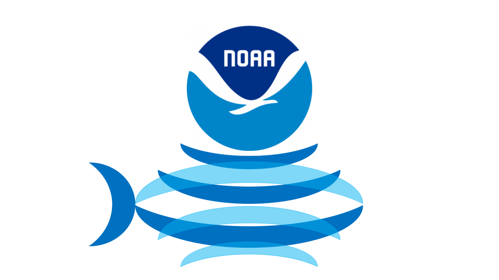
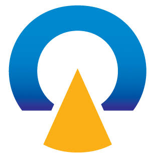

---
search:
  exclude: true
---
<h1 align="center">Echoview COM Tools</h1>

  
  

The Active Acoustics Strategic Initiative aims to modernize active acoustic data processing in NOAA Fisheries. [Echoview](https://echoview.com/) is a commercially-available software package used throughout NOAA to process active acoustic data. With an active Echoview license including the Automation module, most of Echoview's functionalities can be automated. Scripts in any language can be used to create, edit, and export outputs of Echoview workflows through COM objects and the Echoview command interface. This is particularly advantageous for batch processing of multiple Echoview files and improving the scalability of applying workflows to different EK80 datasets.

The links on the left provide Python methods for common Echoview COM utilities. Example scripts and notebooks can be found on the [GitHub repository](https://github.com/AllisonLWhiteSEFSC/Echoview_COM_Tools/tree/main).

!!! warning "Disclaimer"
    This repository is a scientific product and is not official communication of the National Oceanic and Atmospheric Administration, or the United States Department of Commerce. All NOAA GitHub project code is provided on an ‘as is’ basis and the user assumes responsibility for its use. Any claims against the Department of Commerce or Department of Commerce bureaus stemming from the use of this GitHub project will be governed by all applicable Federal law. Any reference to specific commercial products, processes, or services by service mark, trademark, manufacturer, or otherwise, does not constitute or imply their endorsement, recommendation or favoring by the Department of Commerce. The Department of Commerce seal and logo, or the seal and logo of a DOC bureau, shall not be used in any manner to imply endorsement of any commercial product or activity by DOC or the United States Government.
